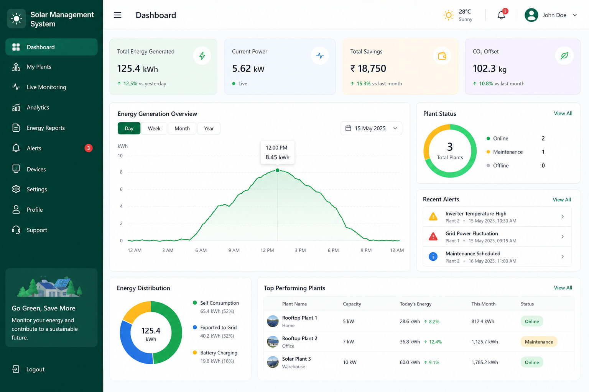
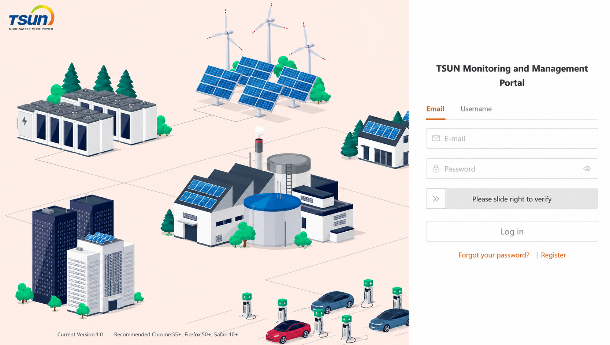
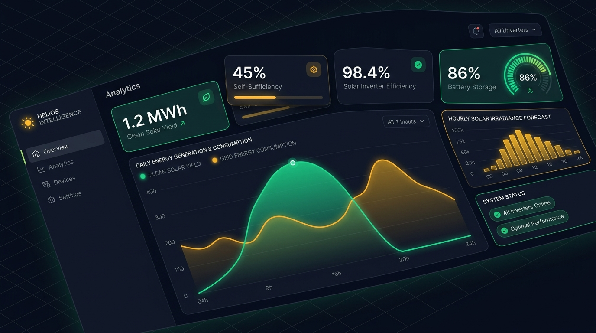
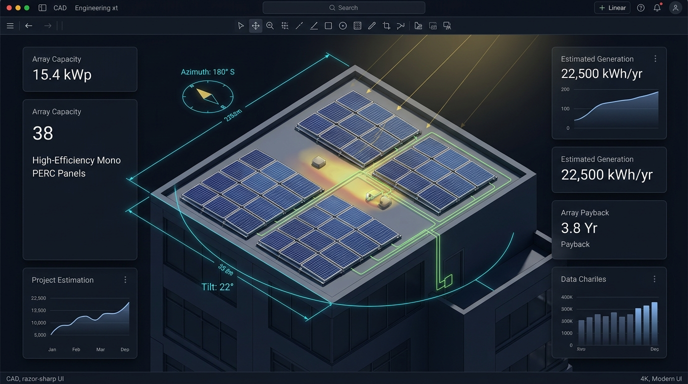
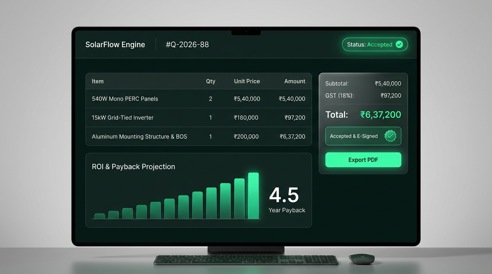
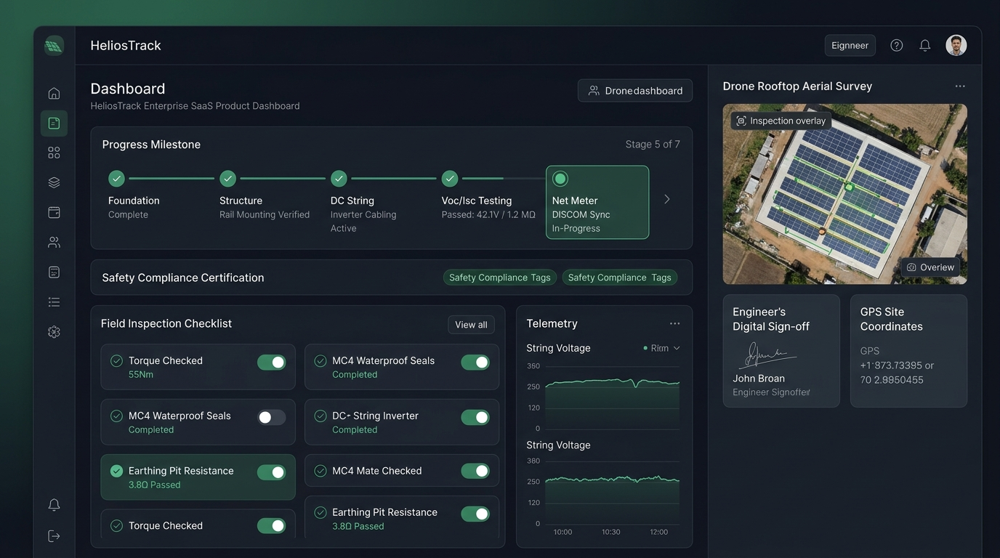
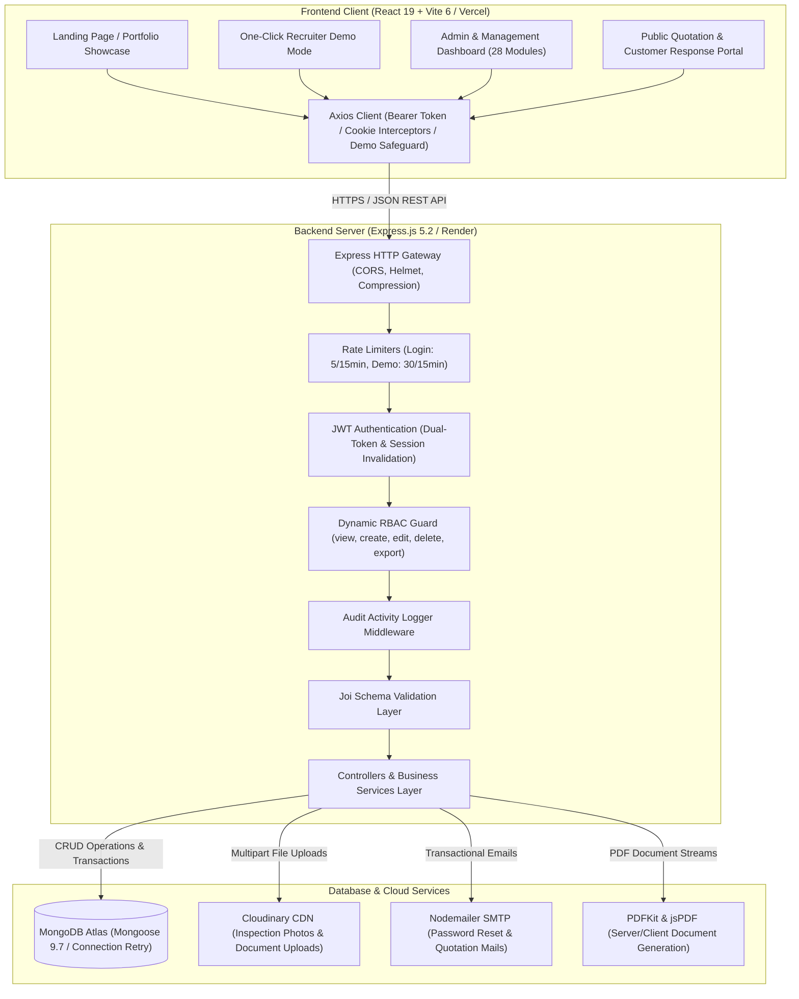

# Solar Management System

[](https://solar-management-system-liard.vercel.app)
[](https://github.com/Devang456/Solar_Management_System)
[](https://nodejs.org)
[](https://react.dev)
[](https://expressjs.com)
[](https://www.mongodb.com)

An enterprise-grade, full-stack **MERN Solar Operations & Energy Management Platform (SolarOps)** built to streamline the complete clean-energy business lifecycle — from lead ingestion, GIS site surveys, and CAD sizing calculations to automated GST quotations, milestone-driven field installations, electrical testing, government subsidy workflows, and real-time solar inverter telemetry.

---

## Table of Contents

- [1. Project Overview](#1-project-overview)
- [2. Live Demo](#2-live-demo)
- [3. Screenshots](#3-screenshots)
- [4. Tech Stack](#4-tech-stack)
- [5. Key Features](#5-key-features)
- [6. User Roles and Permissions](#6-user-roles-and-permissions)
- [7. Project Architecture](#7-project-architecture)
- [8. Project Structure](#8-project-structure)
- [9. Prerequisites](#9-prerequisites)
- [10. Installation and Local Setup](#10-installation-and-local-setup)
- [11. Environment Variables](#11-environment-variables)
- [12. API Documentation](#12-api-documentation)
- [13. Deployment](#13-deployment)
- [14. Security](#14-security)
- [15. Future Improvements](#15-future-improvements)
- [16. Author](#16-author)
- [17. License](#17-license)

---

## 1. Project Overview

Commercial and residential solar energy installations involve multiple stakeholders: sales executives, rooftop survey engineers, electrical CAD designers, warehouse inventory managers, certified field technicians, DISCOM liaison officers, and end clients. Traditional solar companies struggle with fragmented operations managed through disconnected spreadsheets, manual paperwork, delayed customer approvals, and uncoordinated field updates.

The **Solar Management System (SolarOps)** solves this challenge by providing a unified, multi-role SaaS management platform covering the complete **10-stage solar project lifecycle**:

1. **Lead Ingestion & Qualification**: Multi-channel lead tracking, stage-by-stage pipeline, automated follow-up scheduling, and seamless conversion into customer accounts.
2. **Rooftop Site Survey**: GIS coordinates, Leaflet map pinning, physical roof measurements, orientation, obstacle analysis, and electricity bill/photo uploads.
3. **Solar CAD Sizing & Engineering**: Rooftop area simulation, panel capacity calculations, tilt/azimuth angles, string inverter matching, and financial ROI payback schedules.
4. **Dynamic Quotation & Customer Portal**: Automated Bill of Materials (BOM), automated GST tax calculation, instant jsPDF export, and public client review/acceptance links.
5. **Project Approval**: Feasibility review, legal compliance verification, and digital customer acceptance.
6. **Inventory Allocation & Warehousing**: Multi-warehouse stock tracking, serialized solar panel and inverter tracking, low-stock warnings, and stock transfer requests.
7. **Field Installation Execution**: Milestone-based tracking (civil foundation, structure mounting, module laying, inverter wiring), site photo logs, and material requisition.
8. **Electrical Testing & Commissioning**: Open-circuit voltage ($V_{oc}$), short-circuit current ($I_{sc}$), insulation resistance audits, DISCOM net-metering synchronization, and handover certificates.
9. **IoT Telemetry & Solar Monitoring**: Inverter power curves, generation vs. consumption metrics, performance ratios (PR), and carbon offset ($CO_2$) telemetry.
10. **Lifecycle Maintenance, AMC & Support**: Preventative service visit dispatch, annual maintenance contracts (AMC), warranty tracking, and an integrated ticket desk.

---

## 2. Live Demo

- **Live Frontend Application**: [https://solar-management-system-liard.vercel.app](https://solar-management-system-liard.vercel.app)
- **GitHub Repository**: [https://github.com/Devang456/Solar_Management_System](https://github.com/Devang456/Solar_Management_System)

### Recruiter & Evaluator One-Click Demo Mode
To make evaluation effortless for hiring managers and technical recruiters, the system includes a dedicated **One-Click Recruiter Demo Access** directly on the login page:
- Select the **Recruiter Demo** tab on the login screen.
- Click **"Explore Live Demo"** to access the complete application instantly without creating credentials or typing passwords.
- **Data Protection**: Demo accounts are granted full read, explore, filter, and export permissions across all 28+ modules, while state mutation actions (`POST`, `PUT`, `PATCH`, `DELETE`) are safely intercepted by both client-side Axios guards and server-side RBAC middleware to preserve live portfolio data.

---

## 3. Screenshots

The following screenshots illustrate the actual application interface, interactive analytics, and multi-module workflow:

### Executive Operations Dashboard

*Real-time executive dashboard featuring active project status, revenue statistics, technician allocation, and solar telemetry metrics.*

---

### One-Click Recruiter Demo Portal

*Recruiter-friendly authentication interface featuring one-click demo access, telemetry highlights, and standard administrator login tabs.*

---

### Solar Generation & Telemetry Monitoring

*Real-time kilowatt generation vs. consumption curves, inverter status, performance ratios, and carbon offset calculations.*

---

### Rooftop CAD Sizing & Engineering Engine

*Rooftop geometric area calculations, tilt angle optimizations, panel-to-inverter string matching, and financial payback schedules.*

---

### Dynamic Quotation & GST Billing Engine

*Itemized Bill of Materials (BOM), automated GST tax calculation, client email dispatch, and instant jsPDF document generation.*

---

### Field Installation & Technician Operations

*Milestone-driven project deployment tracking, checklist verification, technician attendance, and field inspection photo logs.*

---

> [!NOTE]
> Additional high-resolution screenshots can be placed in `frontend/frontend/src/assets/images/` or in a dedicated `docs/screenshots/` directory.

---

## 4. Tech Stack

### Frontend
- **Framework & Runtime**: [React 19](https://react.dev/) (`v19.2.7`) with modern hooks, Suspense, and functional components.
- **Build Tool**: [Vite 6](https://vitejs.dev/) (`v6.0.7`) with optimized chunk-splitting and lightning-fast HMR.
- **Routing**: [React Router DOM v7](https://reactrouter.com/) (`v7.18.1`) with protected route guards, public links, and dynamic nested routing.
- **Server State & Data Fetching**: [TanStack React Query v5](https://tanstack.com/query/latest) (`v5.101.4`) for asynchronous state management, background caching, and query invalidation.
- **Data Visualization**: [Recharts v3](https://recharts.org/) (`v3.9.2`) providing composed charts, area charts, bar charts, and radar graphs.
- **Geospatial Mapping**: [Leaflet](https://leafletjs.com/) (`v1.9.4`) & [React-Leaflet](https://react-leaflet.js.org/) (`v5.0.0`) for rooftop GPS pinning and technician mapping.
- **Form Handling & Validation**: [Formik](https://formik.org/) (`v2.4.9`) and [Yup](https://github.com/jquense/yup) (`v1.7.1`) for strict multi-step client validation.
- **Document & Spreadsheet Export**: [jsPDF](https://github.com/parallax/jsPDF) (`v4.2.1`), [jspdf-autotable](https://github.com/simonbengtsson/jsPDF-AutoTable) (`v5.0.8`), and [XLSX](https://sheetjs.com/) (`v0.18.5`).
- **HTTP Client**: [Axios](https://axios-http.com/) (`v1.18.1`) with automatic Bearer token injection, multipart form boundary resolution, response envelopes, and mutation safeguards for demo mode.

### Backend
- **Runtime & Architecture**: [Node.js](https://nodejs.org/) (`v18+` / `v20+`) with native ECMAScript Modules (`type: "module"`).
- **Framework**: [Express.js](https://expressjs.com/) (`v5.2.1`) RESTful API architecture.
- **Database ODM**: [Mongoose](https://mongoosejs.com/) (`v9.7.4`) with strict schemas, relational population, lean queries, and connection retry resilience.
- **Authentication & Security**: [JSON Web Tokens (jsonwebtoken)](https://github.com/auth0/node-jsonwebtoken) (`v9.0.3`) with access + refresh token rotation, [bcryptjs](https://github.com/dcodeIO/bcrypt.js) (`v3.0.3`) password hashing, [Helmet](https://helmetjs.github.io/) (`v8.3.0`) secure HTTP headers, and [express-rate-limit](https://github.com/express-rate-limit/express-rate-limit) (`v8.6.2`).
- **Validation**: [Joi](https://joi.dev/) (`v18.2.3`) schema validation for API request bodies and route parameters.
- **File Upload & Cloud Storage**: [Multer](https://github.com/expressjs/multer) (`v2.2.0`) memory storage with MIME filtering, and [Cloudinary SDK](https://cloudinary.com/) (`v2.10.0`) for scalable asset hosting.
- **Server-Side PDF Generation**: [PDFKit](https://pdfkit.org/) (`v0.20.1`) for server-side PDF exports.
- **Email Service**: [Nodemailer](https://nodemailer.com/) (`v9.0.3`) for SMTP email dispatch and password-reset verification links.
- **Performance & Utilities**: [Compression](https://github.com/expressjs/compression) (`v1.8.1`), [Cookie-Parser](https://github.com/expressjs/cookie-parser) (`v1.4.7`), and [Morgan](https://github.com/expressjs/morgan) (`v1.11.0`) HTTP request logger.

### Database & Telemetry
- **Primary Database**: [MongoDB](https://www.mongodb.com/) (Atlas Cloud / Local) for core business entities, user accounts, quotations, inventory, and audit trails.
- **Telemetry Architecture**: Time-series optimized schemas and live telemetry data pipelines for solar inverter performance curves.

### Deployment & Cloud Infrastructure
- **Frontend Hosting**: [Vercel](https://vercel.com/) (Global Edge CDN with Single Page Application rewrites).
- **Backend Hosting**: [Render](https://render.com/) (Node.js Web Service with automatic deploys and health checks).
- **Database Cloud**: [MongoDB Atlas](https://www.mongodb.com/atlas) with replica set high availability.
- **Media CDN**: [Cloudinary](https://cloudinary.com/) for media, survey photos, and document attachments.

---

## 5. Key Features

### 🏢 1. End-to-End Solar Business Lifecycle
- **Unified Pipeline**: Connects sales teams, CAD engineers, warehouse staff, field technicians, and customers into one collaborative system.
- **Zero Data Loss**: Progressively carries data from initial lead capture through site survey, solar CAD sizing, quotation generation, installation milestones, and handover.

### 👥 2. Dynamic Role-Based Access Control (RBAC)
- **Granular Permissions Matrix**: Configures fine-grained action permissions (`view`, `create`, `edit`, `delete`, `export`) across all 39 system modules.
- **Self-Healing Role Seeder**: Pre-seeds default roles while preserving administrator customizations across server restarts.
- **Token Invalidation Engine**: Enforces a `tokenVersion` check on user documents, ensuring instant revocation of compromised sessions upon logout or password reset.

### 🎯 3. Lead & Follow-Up Management
- **Pipeline Staging**: Manage leads through stages (`New`, `Contacted`, `Survey Scheduled`, `Quotation Sent`, `Converted`, `Lost`).
- **Automated Conversion**: Convert qualified leads into verified customer accounts with a single click while maintaining historical activity logs.
- **Follow-Up Reminders**: Filter overdue follow-ups, schedule calls, and record interaction logs.

### 📐 4. Site Survey & Rooftop Audit
- **GIS Geotagging**: Capture exact latitude/longitude coordinates and roof orientation using interactive Leaflet maps.
- **Rooftop Characteristics**: Record roof type (RCC Flat, Metal Sheet, Tiled), available shadow-free area (sq ft / sq m), obstacle details, and electrical connection parameters (Phase, Sanctioned Load).
- **Document Attachments**: Securely upload electricity bills and multiple on-site survey photos.

### ☀️ 5. Solar CAD Sizing & Design Engine
- **Capacity Calculation**: Calculate recommended system capacity (kWp) based on historical electricity consumption, tariff rates, and roof area.
- **Engineering Parameters**: Simulate tilt angles, azimuth orientation, panel wattage, inverter specifications, and string configurations.
- **Financial Payback Analysis**: Compute estimated annual generation (kWh), monthly bill savings, net investment cost, and payback period (years).

### 📄 6. Dynamic Quotations & Customer Approval Portal
- **Automated Bill of Materials (BOM)**: Calculate quantities and costs for solar modules, inverters, mounting structures, ACDB/DCDB boxes, earthing kits, and lightning arrestors.
- **Automated GST & Pricing**: Apply customizable tax rates, trade discounts, and state subsidies.
- **Digital Customer Acceptance**: Send branded quotation links via email. Customers can view and digitally approve or request changes via a public portal (`/quotation/respond/:id`) without needing an account.
- **Client-Side jsPDF**: Generate downloadable, print-ready PDF quotations with company branding and itemized schedules.

### 📦 7. Product Catalog, Inventory & Multi-Warehouse Tracking
- **Serialized Asset Tracking**: Track panels, inverters, and electrical components by model number, serial number, and warranty period.
- **Multi-Warehouse Allocation**: Manage stock across central warehouses and regional hubs with stock transfers and stock requests.
- **Low-Stock Alerts**: Automated threshold notifications preventing project deployment bottlenecks.

### 🔨 8. Field Installation Management
- **Milestone Checklists**: Track multi-stage installations (Civil Foundation, Structure Mounting, Panel Laying, Inverter Wiring, Earthing & Lightning Protection).
- **Field Photo Documentation**: Technicians upload on-site progress photos at each installation phase.
- **Material Requisition**: Request additional hardware or return unused inventory back to warehouse stock.

### ⚡ 9. Electrical Testing, Commissioning & Handover
- **Pre-Handover Testing**: Record test parameters including Open Circuit Voltage ($V_{oc}$), Short Circuit Current ($I_{sc}$), Operating Voltage ($V_{mp}$), and insulation resistance.
- **DISCOM Net-Metering Sync**: Track meter application, inspection clearance, and bi-directional meter installation.
- **Digital Handover**: Generate handover certificates with verified warranty documentation.

### 📊 10. IoT Solar Telemetry & Live Monitoring
- **Performance Curves**: Real-time generation vs. facility consumption curves visualized with Recharts ComposedCharts and AreaCharts.
- **Key Metrics**: Monitor instantaneous power (kW), daily energy yield (kWh), system Performance Ratio (PR %), and estimated $CO_2$ avoided (kg/tons).
- **Alert Dispatch**: Real-time warning triggers for inverter faults, string disconnection, or generation drops.

### 💳 11. Billing, GST Invoices & Receipts
- **Sequential Invoicing**: Automated invoice number generation (`INV-YYYY-XXXX`).
- **GST Compliance**: Itemized CGST, SGST, and IGST computation with HSN/SAC code mapping.
- **Credit Notes & Receipts**: Issue credit notes for adjustments and record partial/full milestone receipts.

### 🏛️ 12. Government Subsidy Management
- **National Portal Workflow**: Track PM Surya Ghar Muft Bijli Yojana and state DISCOM subsidy application lifecycles.
- **Milestone Auditing**: Monitor application submission, technical feasibility approval (TFA), inspection clearance, and subsidy disbursement status.

### 🛠️ 13. Service Visits, AMC & Ticket Desk
- **Support Desk**: Multi-priority ticket management (`Low`, `Medium`, `High`, `Urgent`) with Cloudinary file attachments.
- **Annual Maintenance Contracts (AMC)**: Manage AMC contract validity, scheduled preventive maintenance visits, and customer service history.
- **Warranty Claim Workflow**: Register component warranties and escalate hardware defects directly to vendors.

### 🔍 14. Enterprise Audit Trail & Reports
- **Automatic Activity Logging**: Intercepts successful mutations (`POST`, `PUT`, `PATCH`, `DELETE`) across all 50+ routes, recording user, IP, action, entity, and timestamp.
- **Multi-Domain Analytics**: Export sales performance, project completion timelines, warehouse inventory valuation, and technician productivity reports.

---

## 6. User Roles and Permissions

The platform implements a strict **Role-Based Access Control (RBAC)** model defined in `src/config/roles.js` and enforced by `rbac.middleware.js`:

| Role Name | Description | Key Module Permissions |
| :--- | :--- | :--- |
| **Super Admin** | Unrestricted platform control (`isSystem: true`) | Full `view`, `create`, `edit`, `delete`, `export` across all 39 modules and system configuration. |
| **Company Admin** | Executive operations & team management | Full operational management across leads, projects, billing, inventory, and users; view/export on telemetry and reports. |
| **Sales Manager** | Commercial sales & client onboarding | Full access to Leads, Customers, Quotations, Site Surveys, Solar Design, Project Approvals, and Sales Reports. |
| **Technician** | Field installation, testing & surveys | Site Surveys, Installations, Testing, Commissioning, Daily Progress Logs, Attendance, and Maintenance Tickets. |
| **Customer** | Client self-service portal | Solar Telemetry Monitoring, Ticket Support, Invoice & Payment viewing, Quotations, and Site Survey review. |
| **Accountant** | Financial management & taxation | Full access to Invoicing, GST Invoices, Credit Notes, Receipts, Vendor Payments, and Financial Reports. |
| **Support Team** | After-sales service & maintenance | Full access to Support Tickets, Maintenance Tickets, Service Visits, AMC Contracts, and Warranty Claims. |
| **Recruiter Demo** | Portfolio evaluation showcase (`isDemo: true`) | Universal `view` and `export` across all modules. Mutations (`POST`, `PUT`, `PATCH`, `DELETE`) are safely blocked. |

### Granular Action Permissions
Every module permission is structured as a discrete permission set:
```json
{
  "view": true,
  "create": true,
  "edit": true,
  "delete": false,
  "export": true
}
```

---

## 7. Project Architecture

The application is structured into decoupled frontend, backend, database, and cloud storage layers:



---

## 8. Project Structure

```
Solar_Management_System/
│
├── .gitignore                          # Repository gitignore rules
├── README.md                           # Master project documentation
│
├── backend/                            # Node.js + Express backend service
│   ├── .env.example                    # Backend environment variable template
│   ├── index.js                        # Server entry point, middleware & route mounting
│   ├── package.json                    # Backend dependencies & npm scripts (ES Modules)
│   ├── scripts/                        # Utility & seeding scripts (10k inventory seed)
│   └── src/
│       ├── config/
│       │   └── db.js                   # Mongoose connection with retry loop & DNS fallback
│       ├── constants/                  # HTTP status codes, messages & JWT configuration
│       ├── controllers/                # 45+ business logic controllers
│       │   ├── auth.controller.js      # Auth, demo login, profile & session management
│       │   ├── quotation.controller.js # Quotation BOM, calculations & email dispatch
│       │   ├── lead.controller.js      # Lead management & customer conversion
│       │   ├── installation.controller.js # Installation progress & checklist updates
│       │   └── report.controller.js    # Multi-domain report aggregation & PDF export
│       ├── middlewares/                # Custom Express middleware suite
│       │   ├── auth.middleware.js      # JWT token verification & tokenVersion validation
│       │   ├── rbac.middleware.js      # Fine-grained module & action permission guard
│       │   ├── rateLimiter.middleware.js # IP rate limiting for auth & demo endpoints
│       │   ├── activityLogger.middleware.js # Automatic audit log interception
│       │   ├── upload.middleware.js    # Multer configuration & memory storage
│       │   └── responseEnvelope.middleware.js # Standardized JSON response formatting
│       ├── models/                     # 50+ Mongoose ODM schemas & models
│       │   ├── user.model.js           # User accounts with roles & tokenVersion
│       │   ├── role.model.js           # Dynamic role definitions & permission matrix
│       │   ├── quotation.model.js      # Quotations with itemized BOM items
│       │   ├── siteSurvey.model.js     # Rooftop survey audits & photo references
│       │   ├── solarDesign.model.js    # CAD sizing & payback simulations
│       │   ├── installation.model.js   # Field installation milestones & logs
│       │   └── activityLog.model.js    # System-wide enterprise audit records
│       ├── routes/                     # Modular REST API route handlers
│       │   ├── auth.routes.js          # Authentication, demo access & passwords
│       │   ├── quotationPublic.routes.js # Public tokenless customer acceptance routes
│       │   └── [module].routes.js      # Protected module routes with RBAC guards
│       ├── seeders/                    # Database seeding (roles, departments, users)
│       ├── services/                   # Nodemailer SMTP mail service
│       ├── templates/                  # HTML email templates (Password reset, Quotations)
│       ├── utils/                      # Cloudinary storage, winston logger, helpers
│       └── validations/                # Joi request validation schemas
│
└── frontend/
    └── frontend/                       # React 19 + Vite 6 administration & landing application
        ├── .env.example                # Frontend environment variable template
        ├── index.html                  # HTML entry point with meta tags
        ├── package.json                # Frontend dependencies & npm scripts
        ├── vite.config.js              # Vite configuration (port 3000, JSX loaders, proxy)
        ├── public/                     # Static public assets
        └── src/
            ├── App.js                  # App root, React Router routes & lazy splitting
            ├── index.js                # React DOM render entry point
            ├── admin/                  # 28 Admin & Management UI modules
            │   ├── dashboard/          # Executive dashboard, stat cards, charts & layout
            │   │   ├── Dashboard/      # Main composite dashboard with Recharts views
            │   │   ├── Header/         # Dashboard navigation header with user menu
            │   │   ├── Sidebar/        # Dynamic role-filtered navigation sidebar
            │   │   └── RolePermissions/# Live RBAC matrix configuration editor
            │   ├── login/              # Login screen with One-Click Recruiter Demo tab
            │   ├── leadManagement/     # Lead capture, stages & conversion workflows
            │   ├── customerManagement/ # 360-degree customer records & profiles
            │   ├── quotation/          # Dynamic BOM builder & quotation generator
            │   ├── SiteSurvey/         # Rooftop survey forms & Leaflet map integration
            │   ├── SolarDesign/        # Sizing calculator & payback analysis UI
            │   ├── installations/      # Field milestone progress & checklist forms
            │   ├── technicians/        # Technician dispatch, attendance & GPS views
            │   ├── SolarMonitoring/    # Real-time generation & consumption telemetry
            │   ├── tickets/            # Support ticket desk with file uploads
            │   ├── subsidy/            # PM Surya Ghar & state subsidy tracking UI
            │   └── warehouses/         # Multi-warehouse stock & inventory views
            ├── landing/                # Public landing page showcasing platform
            ├── components/common/      # Toast notifications, loaders, modal dialogs
            ├── context/
            │   ├── AuthContext.js      # User session, login, demo mode & RBAC state
            │   └── NotificationContext.js # In-app notification alerts
            ├── config/
            │   ├── roles.js            # Roles constants, labels & default permission matrix
            │   └── statuses.js         # Unified entity status maps & tone badges
            ├── services/
            │   ├── api.js              # Axios instance, interceptors & API methods
            │   └── index.js            # Unified service exports
            └── utils/                  # Form validation schemas & helper functions
```

---

## 9. Prerequisites

Before running the project locally, ensure you have the following installed on your system:

- **Node.js**: `v18.18.0` or `v20.x` (LTS recommended)
- **npm**: `v9.x` or `v10.x` (installed automatically with Node.js)
- **MongoDB**: Local MongoDB community server running on port `27017` **or** a free [MongoDB Atlas](https://www.mongodb.com/atlas) cloud cluster.
- **Git**: For cloning the repository.
- **Cloudinary Account (Optional)**: For cloud-based photo and document storage (falls back gracefully if omitted).
- **SMTP Credentials (Optional)**: Gmail App Password or SMTP provider for password-reset emails and quotation links.

---

## 10. Installation and Local Setup

Follow these step-by-step instructions to set up the project locally:

### Step 1: Clone the Repository
```bash
git clone https://github.com/Devang456/Solar_Management_System.git
cd Solar_Management_System
```

---

### Step 2: Install Backend Dependencies
```bash
cd backend
npm install
```

---

### Step 3: Configure Backend Environment Variables
Create a `.env` file in the `backend/` directory by copying the example template:
```bash
cp .env.example .env
```
Open `backend/.env` and update the parameters (see [Environment Variables](#11-environment-variables) below).

---

### Step 4: Seed the Database (Recommended)
Seed default departments, roles, and administrative data into MongoDB:
```bash
npm run seed
```
*(Optional)* To populate 10,000 realistic inventory records for performance testing:
```bash
npm run seed:inventory
```

---

### Step 5: Start the Backend Server
```bash
npm run dev
```
The Express backend will start on **`http://localhost:5000`** with nodemon auto-reloading.

---

### Step 6: Install Frontend Dependencies
In a new terminal window, navigate to the frontend directory:
```bash
cd ../frontend/frontend
npm install
```

---

### Step 7: Configure Frontend Environment Variables
Create a `.env` file in `frontend/frontend/`:
```bash
cp .env.example .env
```
Ensure the API base URL points to your local backend:
```env
VITE_API_URL=http://localhost:5000/api
REACT_APP_API_URL=http://localhost:5000/api
```

---

### Step 8: Start the Frontend Application
```bash
npm run dev
```
The Vite development server will start on **`http://localhost:3000`**. Open your browser and navigate to `http://localhost:3000`.

---

## 11. Environment Variables

> [!CAUTION]
> Never commit actual passwords, private keys, or MongoDB credentials to GitHub. Always use `.env.example` as a template and ensure `.env` is listed in `.gitignore`.

### Backend Environment Variables (`backend/.env`)

```env
# ============================================================
# Server Configuration
# ============================================================
PORT=5000
NODE_ENV=development

# ============================================================
# Database Configuration (MongoDB Atlas or Local Instance)
# ============================================================
MONGODB_URL=mongodb://localhost:27017/solar_crm

# ============================================================
# JWT Authentication Configuration
# ============================================================
JWT_SECRET=your_jwt_access_secret_key_here
JWT_EXPIRE=1d
JWT_REFRESH_SECRET=your_jwt_refresh_secret_key_here
JWT_REFRESH_EXPIRE=7d

# ============================================================
# Client Application URLs (CORS & Email Links)
# ============================================================
CLIENT_URL=http://localhost:3000
FRONTEND_URL=http://localhost:3000

# ============================================================
# SMTP Email Service (Optional for Mail Dispatch)
# ============================================================
EMAIL_HOST=smtp.gmail.com
EMAIL_PORT=587
EMAIL_USER=your_email@gmail.com
EMAIL_PASSWORD=your_email_app_password

# ============================================================
# Cloudinary Media Storage (Optional for Document Uploads)
# ============================================================
CLOUDINARY_CLOUD_NAME=your_cloudinary_cloud_name
CLOUDINARY_API_KEY=your_cloudinary_api_key
CLOUDINARY_API_SECRET=your_cloudinary_api_secret

# ============================================================
# Administrative Seeder Defaults (Optional)
# ============================================================
# ADMIN_EMAIL=admin@solar.com
# ADMIN_USERNAME=admin
# ADMIN_PASSWORD=your_secure_password_here
```

### Frontend Environment Variables (`frontend/frontend/.env`)

```env
# ============================================================
# Solar Admin Panel API Base URL
# ============================================================
VITE_API_URL=http://localhost:5000/api
REACT_APP_API_URL=http://localhost:5000/api
```

---

## 12. API Documentation

All API endpoints reside under the `/api` prefix. Protected routes require a valid JWT token via an `Authorization: Bearer <token>` header or `accessToken` cookie.

### Authentication & User Profile (`/api/auth`)
| Method | Endpoint | Purpose | Authentication |
| :--- | :--- | :--- | :--- |
| `POST` | `/api/auth/login` | Sign in with email and password (Rate-limited: 5 attempts/15min) | Public |
| `POST` | `/api/auth/demo-login` | Instant one-click recruiter demo authentication | Public |
| `POST` | `/api/auth/refresh-token` | Generate a new access token using a refresh token | Public |
| `POST` | `/api/auth/logout` | Clear user authentication cookies and session | Public |
| `GET` | `/api/auth/me` | Fetch currently authenticated user details & permissions | Authenticated |
| `GET` | `/api/auth/profile` | Retrieve profile information | Authenticated |
| `PUT` | `/api/auth/profile` | Update profile details (name, phone, settings) | Authenticated |
| `POST` | `/api/auth/profile/photo`| Upload user profile avatar (Cloudinary / Multer) | Authenticated |
| `DELETE`| `/api/auth/profile/photo`| Remove profile photo | Authenticated |
| `POST` | `/api/auth/forgot-password`| Send password reset instructions via email | Public |
| `POST` | `/api/auth/reset-password/:token`| Reset password using a validated token | Public |
| `POST` | `/api/auth/change-password`| Change password for the current user | Authenticated |

---

### Lead Management (`/api/leads`)
| Method | Endpoint | Purpose | RBAC Guard |
| :--- | :--- | :--- | :--- |
| `GET` | `/api/leads` | List all leads with pagination, stage filter & search | `leads:view` |
| `GET` | `/api/leads/analytics` | Retrieve lead conversion rates and pipeline metrics | `leads:view` |
| `GET` | `/api/leads/overdue` | Retrieve overdue follow-ups | `leads:view` |
| `GET` | `/api/leads/:id` | Fetch detailed lead profile and interaction logs | `leads:view` |
| `POST` | `/api/leads` | Create a new solar lead | `leads:create` |
| `PUT` | `/api/leads/:id` | Update lead contact and system requirement data | `leads:edit` |
| `PATCH` | `/api/leads/:id/status` | Advance lead stage (Contacted, Survey, Converted) | `leads:edit` |
| `POST` | `/api/leads/:id/convert` | Convert lead into a registered customer profile | `leads:edit` |
| `DELETE`| `/api/leads/:id` | Remove a lead from the pipeline | `leads:delete` |

---

### Quotations & Customer Acceptance (`/api/quotations` & `/api/public/quotations`)
| Method | Endpoint | Purpose | Authentication |
| :--- | :--- | :--- | :--- |
| `GET` | `/api/quotations` | List quotations with search, filter, and pagination | `quotations:view` |
| `GET` | `/api/quotations/analytics`| Retrieve quotation conversion and revenue metrics | `quotations:view` |
| `GET` | `/api/quotations/stock-requests` | View inventory allocation requests for quotations | `quotations:view` |
| `POST` | `/api/quotations` | Generate a new quotation with itemized BOM and GST | `quotations:create` |
| `GET` | `/api/quotations/:id` | Retrieve quotation details and item schedules | `quotations:view` |
| `PUT` | `/api/quotations/:id` | Update quotation pricing, BOM items, or discounts | `quotations:edit` |
| `PATCH` | `/api/quotations/:id/approve` | Mark quotation approved by management | `quotations:edit` |
| `POST` | `/api/quotations/:id/send-email` | Dispatch branded quotation link to client | `quotations:edit` |
| `DELETE`| `/api/quotations/:id` | Delete quotation | `quotations:delete` |
| `GET` | `/api/public/quotations/:quotationId` | Public client view for email quotation links | **Public** |
| `POST` | `/api/public/quotations/:quotationId/respond`| Public digital client approval or change request | **Public** |

---

### Site Survey & Solar CAD Sizing (`/api/site-surveys` & `/api/solar-designs`)
| Method | Endpoint | Purpose | RBAC Guard |
| :--- | :--- | :--- | :--- |
| `GET` | `/api/site-surveys` | List all rooftop site surveys | `site-survey:view` |
| `POST` | `/api/site-surveys` | Create survey record with bill & rooftop photo uploads | `site-survey:create` |
| `GET` | `/api/site-surveys/:id` | Retrieve survey details, GPS coordinates, and photos | `site-survey:view` |
| `PUT` | `/api/site-surveys/:id` | Update survey measurements and electrical specs | `site-survey:edit` |
| `DELETE`| `/api/site-surveys/:id` | Delete survey record | `site-survey:delete` |
| `GET` | `/api/solar-designs` | List engineering CAD designs | `solar-design:view` |
| `POST` | `/api/solar-designs` | Create CAD sizing simulation with payback calculations | `solar-design:create` |
| `GET` | `/api/solar-designs/:id`| Retrieve sizing simulation, tilt angle & string setup | `solar-design:view` |
| `PUT` | `/api/solar-designs/:id`| Update system configuration parameters | `solar-design:edit` |

---

### Field Installations & Testing (`/api/installations` & `/api/testing`)
| Method | Endpoint | Purpose | RBAC Guard |
| :--- | :--- | :--- | :--- |
| `GET` | `/api/installations` | List ongoing and completed installations | `installations:view` |
| `POST` | `/api/installations` | Create installation project with assigned technicians | `installations:create` |
| `GET` | `/api/installations/:id`| Retrieve installation milestones, checklists, and photos| `installations:view` |
| `PATCH` | `/api/installations/:id/status`| Update milestone progress (Civil, Structure, Wiring) | `installations:edit` |
| `POST` | `/api/installations/:id/material-request`| Submit additional material request to inventory | `installations:edit` |
| `GET` | `/api/testing` | List all electrical test reports | `testing:view` |
| `POST` | `/api/testing` | Record electrical test results ($V_{oc}, I_{sc}$, insulation) | `testing:create` |
| `GET` | `/api/testing/:id` | Retrieve electrical inspection certificates | `testing:view` |

---

### Billing, Invoicing & Receipts (`/api/invoices`, `/api/gst-invoices`, `/api/receipts`)
| Method | Endpoint | Purpose | RBAC Guard |
| :--- | :--- | :--- | :--- |
| `GET` | `/api/invoices` | List invoices with status (Paid, Pending, Overdue) | `billing:view` |
| `POST` | `/api/invoices` | Create GST-compliant invoice with itemized tax | `billing:create` |
| `GET` | `/api/invoices/stats` | Retrieve billing KPI aggregates and revenue totals | `billing:view` |
| `GET` | `/api/invoices/next-number`| Get next sequential invoice number (`INV-XXXX`) | `billing:view` |
| `GET` | `/api/invoices/:id` | Retrieve invoice details | `billing:view` |
| `GET` | `/api/receipts` | View customer payment receipts | `payments:view` |
| `POST` | `/api/receipts` | Record payment receipt against invoice | `payments:create` |

---

### Additional Core Modules Summary
| Prefix | Module Name | Key Operations |
| :--- | :--- | :--- |
| `/api/customers` | Customer Management | Profiles, documents, lifecycle tracking, conversion history |
| `/api/subsidies` | Government Subsidies | PM Surya Ghar tracking, document inspection, disbursement |
| `/api/inventory` | Inventory & Warehouses | Stock allocation, serialized tracking, low-stock warnings |
| `/api/products` | Product Catalog | Panels, inverters, structures, electrical accessories |
| `/api/vendors` | Vendor Operations | Vendor directory, purchase orders, vendor payment ledger |
| `/api/technicians`| Workforce & Field Staff | Technician profiles, attendance, GPS location, task logs |
| `/api/ticket-support`| Customer Support | Multi-priority ticket management with file attachments |
| `/api/maintenance-tickets`| Maintenance Visits | Corrective service visits, engineer dispatch, repairs |
| `/api/amcs` | Annual Maintenance | AMC contract validity, scheduled preventive maintenance |
| `/api/warranties`| Warranty & Claims | Component warranty registration, vendor claim escalation |
| `/api/reports` | Multi-Domain Analytics | Sales, inventory, and technician reports with PDF export |
| `/api/users` & `/api/roles` | RBAC & Administration | User management, role seeder, permissions matrix editor |
| `/api/activity-logs`| Enterprise Audit Trail | Automated tracking of every create, update, and delete |
| `/api/health` | Health Monitoring | API and database connectivity verification |

---

## 13. Deployment

The application is architected for continuous deployment across modern cloud platforms:

### 1. Frontend: Deployed on Vercel
- **Live URL**: [https://solar-management-system-liard.vercel.app](https://solar-management-system-liard.vercel.app)
- **Build Output**: Built using Vite (`npm run build`), generating an optimized production bundle in the `build/` folder.
- **Routing**: Single Page Application (SPA) routing is handled by Vercel edge rewrites, ensuring URLs such as `/admin/dashboard` or `/quotation/respond/:id` resolve cleanly without 404 errors.

### 2. Backend: Deployed on Render
- **Architecture**: Express.js HTTP service running in Node.js production mode.
- **Health Checks**: Render monitors backend uptime via `GET /api/health`.
- **CORS Configuration**: The backend dynamically validates incoming request origins against an allowed list, automatically matching `CLIENT_URL` without opening permissive cross-origin vulnerabilities.

### 3. Database: Hosted on MongoDB Atlas
- **Resilience**: The database connection in `backend/src/config/db.js` includes an automatic 5-attempt retry loop with exponential delay and IPv4 DNS resolution fallback for zero-downtime startup.

### 4. Zero Secret Exposure
- The frontend interacts with the backend strictly through public REST API endpoints defined by `VITE_API_URL`.
- Sensitive secrets (MongoDB connection strings, JWT signing keys, SMTP credentials, Cloudinary API secrets) remain securely isolated in backend environment variables.
- Authentication tokens are transmitted via `Authorization: Bearer <token>` headers and secure, `HttpOnly`, `SameSite: None` cookies.

---

## 14. Security

The codebase implements comprehensive security practices verified directly in the source code:

1. **HTTP Security Headers**: Uses [Helmet](https://helmetjs.github.io/) to enforce standard security headers, disable MIME-type sniffing, and configure Cross-Origin policies.
2. **IP-Based Rate Limiting**:
   - `loginRateLimiter`: Enforces a maximum of 5 login attempts per 15 minutes per IP address in production to mitigate brute-force credential stuffing.
   - `demoRateLimiter`: Configures a distinct threshold (30 requests per 15 minutes) for recruiter demo access.
3. **Password Security**: Passwords are encrypted using [bcryptjs](https://github.com/dcodeIO/bcrypt.js) with randomized salt rounds prior to persistence.
4. **Dual-Token JWT Architecture**: Employs short-lived access tokens (`1d`) paired with long-lived refresh tokens (`7d`) stored in `HttpOnly` secure cookies.
5. **Session Invalidation (`tokenVersion`)**: Every user document maintains an integer `tokenVersion`. Changing a password, revoking a user, or logging out increments this counter, immediately invalidating all previously issued tokens.
6. **Strict Role-Based Access Control (RBAC)**: All sensitive routes are guarded by dynamic `checkPermission(module, action)` middleware that verifies action-level permissions (`view`, `create`, `edit`, `delete`, `export`) before executing controller logic.
7. **Recruiter Demo Protection**: Both client-side Axios request interceptors and server-side RBAC middleware intercept mutation operations (`POST`, `PUT`, `PATCH`, `DELETE`) for demo accounts, returning friendly alerts and preserving database integrity.
8. **Schema Validation**: All incoming requests are validated against strict [Joi](https://joi.dev/) schemas, rejecting unexpected payloads before reaching the database layer.
9. **Protected File Storage**: Files uploaded to `/uploads` are guarded by `authMiddleware`, ensuring private customer contracts and bills cannot be accessed without valid credentials (while public quotation links remain accessible via `/uploads/public/`).
10. **Enterprise Activity Audit Logging**: Every state-changing request (`POST`, `PUT`, `PATCH`, `DELETE`) is captured by `activityLogger.middleware.js` and recorded in MongoDB with user attribution, IP address, and entity timestamps.

---

## 15. Future Improvements

The following features represent planned enhancements for future iterations of the platform:

- [ ] **Direct IoT Inverter Telemetry Integration**: Native MQTT broker clustering (EMQX / Mosquitto) for direct, sub-second telemetry ingestion from Sungrow, Huawei, and SolarEdge commercial inverters.
- [ ] **Field Technician Mobile App**: Dedicated React Native or Flutter mobile application supporting offline site surveys, camera barcode scanning for hardware serial numbers, and background GPS tracking.
- [ ] **Satellite Rooftop AI Analysis**: Integration with Google Solar API or satellite imaging models to automatically measure roof area, tilt, and tree shading from address inputs.
- [ ] **Automated Payment Gateway Webhooks**: Webhook event listeners for Razorpay and Stripe to automatically reconcile milestone invoices upon payment capture.
- [ ] **Direct DISCOM Net-Metering API Sync**: Automated submission of rooftop solar applications to state electricity utility portals.
- [ ] **Multi-Tenant Organization Support**: Tenant isolation enabling solar EPC companies to manage their own branded subdomains, logos, and distinct databases.

---

## 16. Author

**Devang Parmar**  
*MERN Stack Developer & Full-Stack Engineer*  
- **GitHub**: [@Devang456](https://github.com/Devang456)  
- **Repository**: [https://github.com/Devang456/Solar_Management_System](https://github.com/Devang456/Solar_Management_System)  
- **Live Application**: [https://solar-management-system-liard.vercel.app](https://solar-management-system-liard.vercel.app)

---

## 17. License

The backend package configuration specifies the **ISC** license:
```json
"license": "ISC"
```

A standalone `LICENSE` file is not currently committed to the root repository. If you plan to use, fork, or adapt this software for open-source or commercial purposes, please refer to the standard ISC license terms or open an issue on the repository to request formal licensing documentation.

